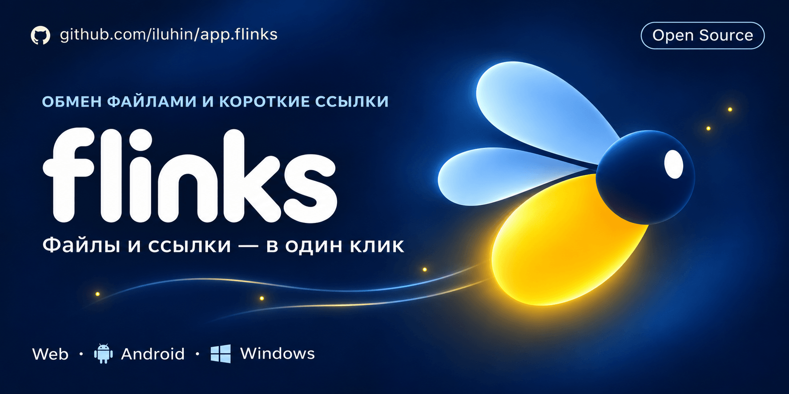

[Русский](README.md) · **English** · [Español](README.es.md) · [简体中文](README.zh-CN.md)

# Flinks

**A file or a link — in one click.** A website with no registration, an
Android app, and a Windows program that automatically puts the short link
on your clipboard.

[**▶ Open in your browser**](https://links.iluh.in/) ·
[**⬇ Android**](https://links.iluh.in/update.php?a=download) ·
[**⬇ Windows**](../../releases/latest) ·
[**📖 Wiki**](../../wiki)

---

## What it is

Two things usually handled by separate services, brought together in one:

| | |
|---|---|
| 📎 | **File → link.** Drag and drop to get a short address you can share. Multiple files are packed into an archive. |
| ✂️ | **Long address → short one.** The same address, just readable and short enough to fit in a message. |
| 📷 | **Link → QR code.** Transfer it to your phone without sending it in a message. |

No registration needed: guests have access to everything, with lower limits —
smaller files and shorter storage times. A profile raises those limits and adds
a list of your files and links.

## Android app

- **Works from Share («Поделиться»).** Send a file or link straight from any
  other app — your gallery, file manager, or browser — without opening Flinks.
- **App icon shortcuts.** Long-press the icon to go straight to «Загрузить файл»
  (Upload file), «Ссылка из буфера» (Link from clipboard), «Сократить»
  (Shorten), or «Мои файлы» (My files).
- **Doesn't wait for other websites.** Fonts and the archive packer are bundled
  in the package, so the page can load even when other domains are unreachable.
- **Updates itself.** The app tells you about new versions, including the
  version number, size, and changelog; the system download manager downloads
  the file.
- **Requires** Android 7.0 or newer. About 370 KB, with no ads or trackers.

Get the file from the [releases page](../../releases) or
[the website](https://links.iluh.in/update.php?a=download) — it is signed with
the same key in both places, so updates install over the existing app.

## Windows program

It is not a window displaying the website: you already have a browser at hand.
It cuts out extra steps.

- **Drag files into the window** — the short link is already on your clipboard.
- **Send to («Отправить») in File Explorer** does the same without opening
  the window.
- **Ctrl+Shift+L** turns a long link on the clipboard into a short one.
- **A single file.** No need to install .NET or extra libraries; the program
  checks for updates and replaces itself.

Requires Windows 10 or newer, 64-bit. Get the file from the
[releases page](../../releases).

## iPhone and other systems

There is no separate iPhone app, but the website is a PWA: Share («Поделиться»)
→ Add to Home Screen («На экран „Домой“») gives you an icon and launches it
without an address bar. In Chrome on Android and desktop, use the «⋮» menu →
Install app («Установить приложение»).

## Version history

All releases with descriptions are on the [releases page](../../releases):
the Android app and Windows program have separate version numbers (`v1.7`
and `win-v1.4`). The newest files are always attached to the
[latest release](../../releases/latest), and the website serves the same
files. Brief notes on every version are [in the wiki](../../wiki/Versions).

## What's in this repository

Only releases and information about the service: release notes, cover image,
icon, and wiki. The source code for the website, Android app, and Windows
program is currently closed.

## Questions and suggestions

[Issues](../../issues) — if something breaks, a file fails to upload, or you
have an idea.

---

© Илья Анисимов · [iluh.in](https://iluh.in)
