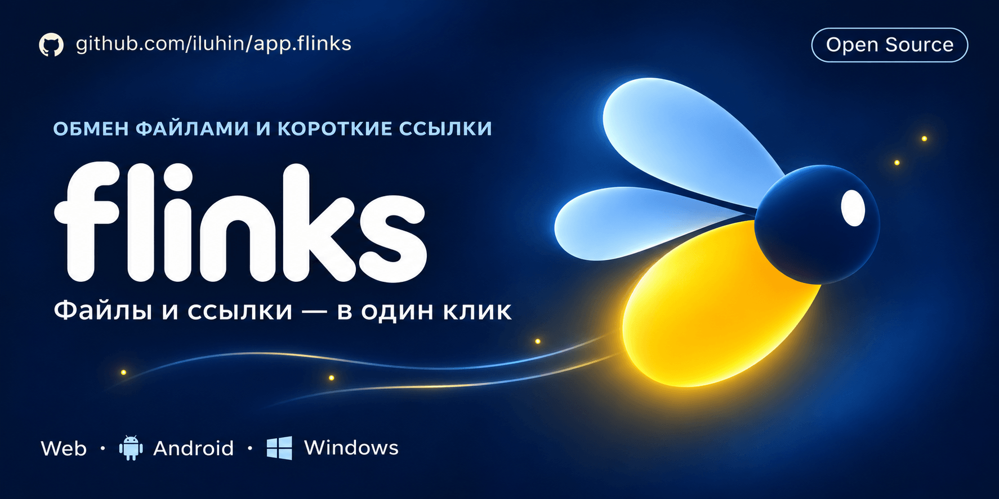

# Flinks

**Файл или ссылка — в один клик.** Сайт без регистрации, приложение для
Android и программа для Windows, после которой короткая ссылка оказывается в
буфере обмена сама.

[**▶ Открыть в браузере**](https://links.iluh.in/) ·
[**⬇ Android**](https://links.iluh.in/update.php?a=download) ·
[**⬇ Windows**](../../releases/latest) ·
[**📖 Вики**](../../wiki)

---

## Что это

Два дела, которые обычно делают разными сервисами, здесь делаются одним:

| | |
|---|---|
| 📎 | **Файл → ссылка.** Перетащили — получили короткий адрес, которым можно поделиться. Несколько файлов упаковываются в архив. |
| ✂️ | **Длинный адрес → короткий.** Тот же адрес, только читаемый и помещающийся в сообщение. |
| 📷 | **Ссылка → QR-код.** Чтобы передать её на телефон, не пересылая. |

Регистрация не нужна: гостю доступно всё, только условия скромнее — файл
поменьше и живёт поменьше. Профиль поднимает потолок и добавляет список своих
файлов и ссылок.

## Приложение для Android

- **Работает из «Поделиться».** Файл или ссылку можно отправить прямо из
  любого другого приложения — галереи, файлового менеджера, браузера, — не
  открывая Flinks.
- **Меню на значке.** Долгое нажатие на значок — и сразу «Загрузить файл»,
  «Ссылка из буфера», «Сократить», «Мои файлы».
- **Не ждёт чужие сайты.** Шрифты и упаковщик архивов лежат внутри пакета,
  поэтому страница собирается, даже когда до чужих доменов не достучаться.
- **Обновляется само.** О новой версии сообщает само приложение — с номером,
  размером и списком изменений; файл скачивает системный диспетчер загрузок.
- **Нужен** Android 7.0 или новее. Около 370 КБ, ни рекламы, ни трекеров.

Файл берите [со страницы выпусков](../../releases) или
[с сайта](https://links.iluh.in/update.php?a=download) — он подписан одним и
тем же ключом, поэтому обновление встаёт поверх установленного приложения.

## Программа для Windows

Не окно с сайтом: браузер и так под рукой. Она убирает лишние действия.

- **Перетащили файлы в окно** — короткая ссылка уже в буфере обмена.
- **«Отправить» в Проводнике** делает то же, не открывая окно.
- **Ctrl+Shift+L** превращает длинную ссылку из буфера в короткую.
- **Один файл.** Ни .NET, ни библиотек доустанавливать не нужно; программа
  сама проверяет обновления и заменяет себя.

Нужна Windows 10 или новее, 64 бита. Файл — на
[странице выпусков](../../releases).

## iPhone и другие системы

Отдельного приложения для iPhone нет, но сайт — это PWA: «Поделиться» → «На
экран „Домой“» даёт значок и запуск без адресной строки. В Chrome на Android и
на компьютере — меню «⋮» → «Установить приложение».

## История версий

Все выпуски с описанием — на [странице выпусков](../../releases): приложение и
программа нумеруются отдельно (`v1.7` и `win-v1.4`). Свежие файлы всегда висят
на [последнем выпуске](../../releases/latest), их же отдаёт сайт. Коротко обо
всех версиях — [в вики](../../wiki/Versions).

## Что внутри этого репозитория

Только выпуски и описание сервиса: заметки к версиям, обложка, значок и вики.
Исходный код сайта, приложения и программы пока закрыт.

## Вопросы и пожелания

[Issues](../../issues) — если что-то сломалось, файл не загрузился или есть
идея.

---

© Илья Анисимов · [iluh.in](https://iluh.in)
