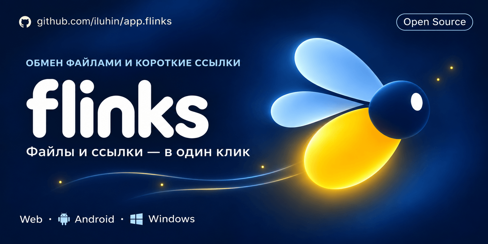

[Русский](README.md) · [English](README.en.md) · [Español](README.es.md) · **简体中文**

# Flinks

**文件或链接，一键搞定。** 无需注册的网站、Android 应用，以及能自动将短链接
复制到剪贴板的 Windows 程序。

[**▶ 在浏览器中打开**](https://links.iluh.in/) ·
[**⬇ Android**](https://links.iluh.in/update.php?a=download) ·
[**⬇ Windows**](../../releases/latest) ·
[**📖 维基**](../../wiki)

---

## 这是什么

通常需要不同服务完成的两件事，在这里用一个服务就能搞定：

| | |
|---|---|
| 📎 | **文件 → 链接。** 拖入文件，即可获得可分享的短地址。多个文件会打包成压缩包。 |
| ✂️ | **长地址 → 短地址。** 仍然是同一个地址，只是更易读，也更适合放进消息中。 |
| 📷 | **链接 → 二维码。** 无需发送消息，即可将链接传到手机上。 |

无需注册：访客也能使用所有功能，只是限制更严格——可上传的文件更小，保存时间
更短。个人账号可以提高限额，并查看自己的文件和链接列表。

## Android 应用

- **支持从“分享”（«Поделиться»）操作直接使用。** 无需打开 Flinks，即可从
  其他应用（图库、文件管理器、浏览器等）直接发送文件或链接。
- **图标快捷菜单。** 长按图标，即可直接使用 «Загрузить файл»（上传文件）、
  «Ссылка из буфера»（剪贴板中的链接）、«Сократить»（缩短链接）、
  «Мои файлы»（我的文件）。
- **无需等待其他网站。** 字体和压缩打包工具都包含在安装包中，即使无法访问
  其他域名，页面也能正常加载。
- **自动更新。** 应用会自行提示新版本，并显示版本号、大小和更新内容；
  文件由系统下载管理器下载。
- **需要** Android 7.0 或更高版本。约 370 KB，无广告，无跟踪器。

可从[发布页面](../../releases)或
[网站](https://links.iluh.in/update.php?a=download)下载安装文件；两处的文件均使用
同一密钥签名，因此可以直接覆盖已安装的应用进行更新。

## Windows 程序

它不是一个显示网站的窗口：你已经有浏览器了。它能帮你省去多余的操作。

- **将文件拖入窗口**，短链接就会自动进入剪贴板。
- **文件资源管理器中的“发送到”（«Отправить»）** 也能完成同样的操作，
  无需打开窗口。
- **Ctrl+Shift+L** 可将剪贴板中的长链接转换为短链接。
- **仅一个文件。** 无需额外安装 .NET 或其他库；程序会自行检查更新并替换自身。

需要 64 位 Windows 10 或更高版本。可在[发布页面](../../releases)下载安装文件。

## iPhone 和其他系统

没有独立的 iPhone 应用，但网站是 PWA：通过“分享”（«Поделиться»）→
“添加到主屏幕”（«На экран „Домой“»），即可添加图标，并在启动时隐藏地址栏。
在 Android 和电脑上的 Chrome 中，可通过“⋮”菜单 →“安装应用”
（«Установить приложение»）进行安装。

## 版本历史

所有版本及说明均在[发布页面](../../releases)：Android 应用和 Windows 程序
分别编号（`v1.7` 和 `win-v1.4`）。最新文件始终附在
[最新发布版本](../../releases/latest)中，网站提供的也是这些文件。
所有版本的简要说明见[维基](../../wiki/Versions)。

## 此仓库包含什么

仅包含发布版本和服务介绍：版本说明、封面、图标和维基。网站、Android 应用及
Windows 程序的源代码目前仍为闭源。

## 问题与建议

如果出现故障、文件上传失败，或你有任何想法，请前往 [Issues](../../issues)。

---

© Илья Анисимов · [iluh.in](https://iluh.in)
